# paude

Claude Code sessions you can reach from anywhere and work in together: the real `claude` CLI, running on your machine or a server, shared between terminals and browsers.

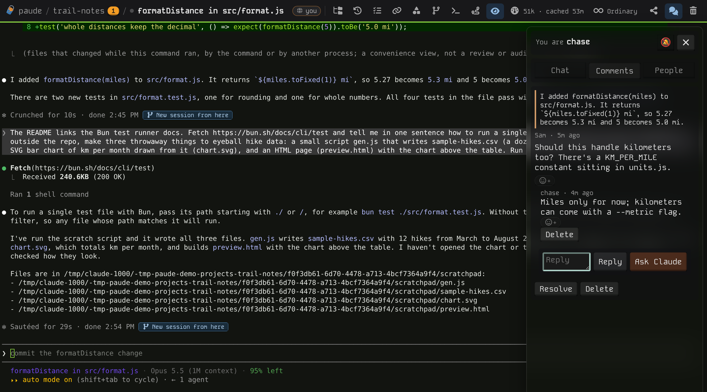

- **One session, many screens.** Every session is `claude` in a pseudo-terminal. Everyone attached sees the same screen, from a terminal (the `paude` command) or a browser, phones included. Walk away from one device and pick up on another; the session keeps running.
- **Company.** Invite people by link as drivers, commenters or viewers. They get a chat, comments on selected output, and emoji reactions, all between people unless someone presses **Ask Claude**: then it's typed into Claude, and Claude's answer comes back to the chat or the comment's thread.
- **The project at hand.** Browse, search and read the session's files, with syntax highlighting and rendered markdown, and attach a file or a few lines to the prompt.
- **Reviewing work.** Start a worktree on someone's branch or pull request, comment on lines of code and post them to the pull request as one review (or bring its threads in), see only what's new since you last reviewed, and get walked through a file, a function or a change, its files read in an order that makes sense of it.
- **What needs you.** Watched sessions show whether Claude is working, waiting on you, or ready, and how much happened since you last looked, across every paude you use.

Sessions are ordinary Claude Code sessions, stored under `~/.claude/projects`; `claude --resume <id>` opens one directly, though not while paude has it open.

## On your machine

Needs [Bun](https://bun.sh) and Claude Code, logged in.

```sh
git clone https://github.com/fatlard1993/paude && cd paude
bun install && bun link   # puts `paude` on your PATH
cd ~/work/my-app
paude add                 # this folder becomes a project; this machine's paude starts in the background
paude                     # the picker: sessions and projects here and on every paude you're logged into
```

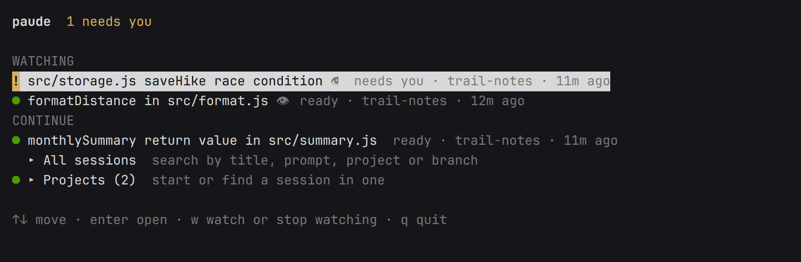

Working on paude itself? `sh scripts/install.sh --dev` from your checkout runs that checkout as this machine's paude service (systemd, or launchd on macOS): it restarts itself as you save, rebuilds the web client and reloads open pages, and sessions carry on through it. Running the installer without `--dev` goes back to an installed copy. With the service stopped, `bun run dev` runs the checkout in the foreground instead: type `b` (or `build`) to rebuild the web client, `stop` to end it.

`bun test` runs the unit tests (the pre-push hook does too). `bun run test:e2e` drives the web client in Chrome against a fake Claude that draws the way Claude Code does, in three browsers: xterm's DOM renderer, its GPU renderer, and a Mac. `bun run test:claude` does the same against the real Claude Code, at the cost of a few tokens. Both look for Chrome in the usual places, or `CHROME`.

Locally there is no password: the server keeps an owner token in `~/.paude/local-token`, readable only by you, and the `paude` command uses it. `paude web` opens this machine's paude in a browser, already logged in. Folders under `~/Projects` are projects without being added. `paude add` takes several folders, or a pattern: `paude add '~/Projects/minecraft/*'` makes each folder in there a project of its own. `paude remove <name>...` takes projects off the list: an added folder is forgotten, one under `~/Projects` is hidden until you add it again. Nothing on disk changes either way, and the home page's project cards do the same. The `paude` command looks for this machine's paude at `http://127.0.0.1:8044` and its token in `~/.paude`; `PAUDE_LOCAL_URL` and `PAUDE_DATA` point it elsewhere. `paude stop` stops the background server (after pulling an update, say); the next `paude` starts it again. The first session in a folder Claude Code hasn't seen asks, in the session, whether you trust it.

## On a server

The same server, kept running as a service and reachable from elsewhere. On Linux with a systemd user session, or macOS:

```sh
curl -fsSL https://raw.githubusercontent.com/fatlard1993/paude/main/scripts/install.sh | sh
cd ~/.paude-server && bun run set-password
```

That installs to `~/.paude-server` and runs a user service (a launchd agent on macOS, which also links the `paude` command) on `127.0.0.1:8044`, serving the folders in `~/Projects`; running it again updates it. Elsewhere, run it yourself: `bun install`, `NODE_ENV=production bun run build`, `bun run set-password`, then `bun start -- --projects ~/Projects`.

| Option             | Default              |                                            |
| ------------------ | -------------------- | ------------------------------------------ |
| `--projects`       | `~/Projects`         | each subfolder is a project                |
| `--host`, `--port` | `127.0.0.1`, `8044`  | where paude listens                        |
| `--data`           | `~/.paude`           | logins, chat, comments, added folders      |
| `--claude`         | `claude` on the PATH | the Claude Code executable                 |
| `--preview-port`   | `--port` + 1         | where shared services and files are served |

Logins need HTTPS: the login cookie is `Secure`, which browsers accept only over https or on localhost. Put a TLS proxy in front instead of exposing the port. With Caddy and no domain name, Let's Encrypt can certify the server's IP address:

```
203.0.113.7 {
	tls {
		issuer acme {
			profile shortlived
		}
	}
	reverse_proxy 127.0.0.1:8044
}

203.0.113.7:8444 {
	tls {
		issuer acme {
			profile shortlived
		}
	}
	reverse_proxy 127.0.0.1:8045
}
```

The second site is where sessions share their services and files (see [Sharing](#sharing)): port 8444 in front of paude's preview port. It's a separate origin on purpose, so an app shown there can't act as you on paude. Another port in front of it goes in `~/.config/paude/server.json` as `{ "previewPort": 9444 }`.

For a phone on the same network instead, Caddy can sign for the machine's own name with its own certificate authority, which the phone then trusts once (on an iPhone: install the profile, then turn it on under Settings → General → About → Certificate Trust Settings). Caddy keeps that authority's certificate in its data folder as `pki/authorities/local/root.crt`:

```
{
	skip_install_trust
}

workbook.local {
	tls internal
	reverse_proxy 127.0.0.1:8044
}

workbook.local:8444 {
	tls internal
	reverse_proxy 127.0.0.1:8045
}
```

Then, from any machine: `paude login https://203.0.113.7 --name vps` (the name is how the picker shows it; `paude name <url> <name>` renames a login you have). A server can name itself too: `paude name vps` on the server puts the name in its browser tab title and is what other machines show it as, unless they gave it a name of their own. A session nobody is attached to exits after an hour (later if Claude is still working); opening it again resumes it. With [dtach](https://github.com/crigler/dtach) installed (`paude doctor` checks), sessions keep running through a server restart or update, and the new server takes them back.

A paude on your own network behind Caddy's `tls internal` has a certificate from that Caddy's own authority, which nothing trusts yet. Put the authority's root certificate (`root.crt`, under Caddy's `pki/authorities/local`) in `~/.config/paude/certificates.pem` on the machine logging in. That file can hold several, one after another. The paude command and this machine's server then trust them, and a browser needs the same certificate trusted on its own.

## Sharing

What a session runs and makes can be opened from any device logged in to paude, at its own address on the preview port (8444 behind Caddy): `https://<host>:8444/s/<name>/`. The share button in a session's bar lists them, with links to open or copy, and buttons to rename (its address) or stop each. A service is named for its project and port (`shop-5173`) until it's renamed.

- **Services.** A server the session starts (a dev server Claude runs, or one from its terminal) is found once it listens and shared while it does. Any other port on the machine can be forwarded by hand. An app's own absolute paths (`/assets/app.js`) and WebSockets (a dev server's live reload) work without telling it about the `/s/<name>/` prefix.
- **Files.** A file in the project to download, or a folder as a zip.
- **Sites.** A folder served as a website, a built `dist/` say, with no server running.

Only people logged in who can see the session open them: the owner, and that session's invitees. Sharing something new takes the drive role. The preview port is another origin, so a shared app's code can't reach paude's API as whoever is looking at it, and paude's login cookie is never passed on to the app.

## Worktrees

Starting a session in a git project asks where it should go. It shows how many sessions run here and in which checkout, then offers the main checkout, a worktree to join, or a new one. In the browser that's under the prompt on the project page; in the terminal, a step after **＋ New session**.

A new worktree goes in `.paude/worktrees/<name>` inside the project, on a branch of the same name. Left unnamed, it's named after the first words of the prompt. Paude adds `.paude/` to the repo's local exclude file, so the main checkout never lists it as untracked. Every worktree of the repo can be joined, wherever it lives; once joined, it counts as part of the project rather than a project of its own.

**A new worktree from a branch or PR** starts where someone else's work is, to review it or try it: a branch (here or on origin, fetched first, and tracked), a tag, a commit, or a pull request (`#123`, `123`, or its link). A pull request is checked out the way `gh pr checkout` does it, a fork's branch included; without `gh`, from GitHub's own ref on origin. The folder is named for it (`pr-123`, `alice-fix-auth`). If there's nothing by that name, the worktree isn't left behind (one made by the repository's own tool goes by its remove command). A branch another checkout already has, such as `main`, starts detached at its commit. A pull request that adds or changes files Claude Code reads and can run on start (anything in a `.claude` folder, `.mcp.json`, `CLAUDE.md` or `CLAUDE.local.md`, at any depth) is checked out, but Claude isn't started: the page and the terminal name the files and ask. **Start anyway** starts it; **Don't start** leaves the worktree to look over and says where it is.

Deleting a session also removes the worktree paude made for it, once no other session, running or saved, is in it. A worktree with uncommitted changes is kept, and the page says so. The branch stays.

A repo with its own way of making worktrees (a workspace tool that installs dependencies, say) gets an entry in `~/.config/paude/worktrees.json`. The key is the repo's remote, so one entry works on every machine, or the main checkout's path:

```json
{
	"github.com/org/repo": {
		"create": "yarn tool workspace create {name}",
		"remove": "yarn tool workspace remove {name}"
	}
}
```

The commands run in the main checkout. `{name}` and `{path}` are filled in already quoted, so don't put quotes around them; they're also in `$PAUDE_WORKTREE_NAME` and `$PAUDE_WORKTREE_PATH`. The new worktree is whichever one appears, so the tool can name and place it as it likes. Its output shows on the page, or in the terminal, while it runs. Without `remove`, it's `git worktree remove`.

## Who can do what

The password belongs to the owner, and the owner can type into any session, which means running commands as the server's user. Give it only to someone you'd give that shell.

Everyone else comes in by invite: in a session's **People** tab, name the person, pick a role and an expiry (an hour, a day, a week), and send them the link. It opens that one session, in a browser or with `paude login <link>`.

A Drive invite can type into Claude, which runs commands as the server's user: give it to someone you'd give that shell, as with the password.

| Role    | Can                                                                      |
| ------- | ------------------------------------------------------------------------ |
| Drive   | type into Claude, open a terminal, edit files, and everything below |
| Comment | chat, comment, read the project's files                                  |
| View    | see the terminal                                                         |

Other servers this machine is logged into (with `paude login`) show on the home page only for this machine's own logins: the paude command and `paude web`. A password login from elsewhere doesn't get them, so one server's password doesn't open the rest. On a machine only your own network reaches (a laptop serving your phone), `{ "shareRemotes": true }` in `~/.config/paude/server.json` lists them for the password too. Invites never get them. Where they show, a pill beside paude in the breadcrumbs names the server you're on, and its menu goes to another's home page, logged in.

In chat and comments the owner goes by this machine's user name, or by `ownerName` in that same file (`{ "ownerName": "Alice" }`) where the user is a service account. The paude command goes by your own user name, or `PAUDE_NAME`. A guest goes by the name on their invite.

Revoking an invite, or changing the password with `bun run set-password` (a running server picks it up), signs those people out everywhere at once.

## In the terminal

Inside a session everything goes to Claude except **Ctrl+]** (**Cmd+]** on a Mac, in a terminal that passes it on, such as kitty), which floats the box over Claude's screen. Claude keeps working behind it. A terminal that keeps Cmd+] for itself (iTerm2, Ghostty) can be set to send Ctrl+] (the byte `0x1d`) for it instead.

The box's top line says how long the session lasts, whether you watch it, and whether Claude's cache still holds it.

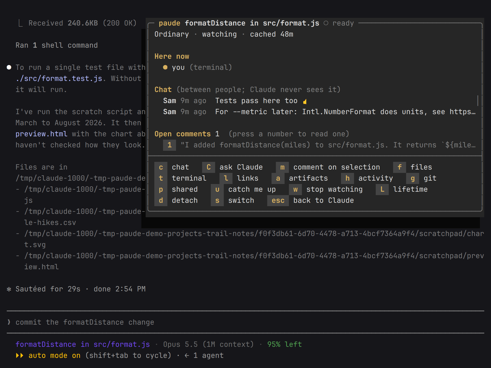

| Key |  |
| --- | --- |
| **c** | chat |
| **m** | comment on your selection (Shift+drag over Claude's output first; on macOS, copy it) |
| **C** | ask Claude: typed into Claude as a prompt, its answer posted back in the chat |
| **1**-**9** | open a comment's thread; there, **o** opens the lines it's on (in the diff it was written in, or the file), **r** replies, **A** asks Claude (its answer lands in the thread), **x** resolves (or reopens), **+** then a number reacts, **D** twice deletes it |
| **f** | the project's files |
| **t** | a terminal: a shell in the session's folder, for a few quick commands. Ctrl+] brings the box back over it: **a** quotes your selection in Claude's prompt, **k** ends it, **Esc** returns to it. It ends when you go back to Claude |
| **l** | links: the docs, tickets, repos and servers that came up, by kind; **Enter** opens one in your browser, **y** copies, **p** pins, **x** hides, **i** includes what only a command printed |
| **a** | artifacts: what the session made, wherever it landed; **Enter** reads it here (an image in place, where the terminal shows images), **o** saves it to `~/Downloads/paude` and opens it, **y** copies its path |
| **D** | decisions: what the session settled and where it's recorded, unrecorded first; **a** answers what paude asks to file one into its commit, **w** asks Claude to record one, **x** sets one aside |
| **h** | activity: whether what changed was tested since, then Claude's turns, newest first; **Enter** shows a turn's steps, where **Enter** opens a step's file and **c** shows what the turn changed |
| **g** | git: status, history, branches, the pull request and the commits not pushed, a tab each; **Enter** on a changed file or a commit shows its diff, **s** settles what was filed into the commits not pushed |
| **p** | shared: the services, files and sites the session shares; **Enter** opens one in your browser |
| **u** | catch me up: says what the tour is and asks; taken, an overview (with whether what changed was tested since, and what the tour leaves out), then a stop per turn (**→** and **←**), each marked where someone stopped Claude, redirected it or turned down a step |
| **w** | watch the session, or stop |
| **L** | how long the session lasts (the owner's): ordinary, kept warm or short-lived, and **Put back** for the last switch while it still can be |
| **s**, **d** | switch session, detach |
| **Esc** | back to Claude |

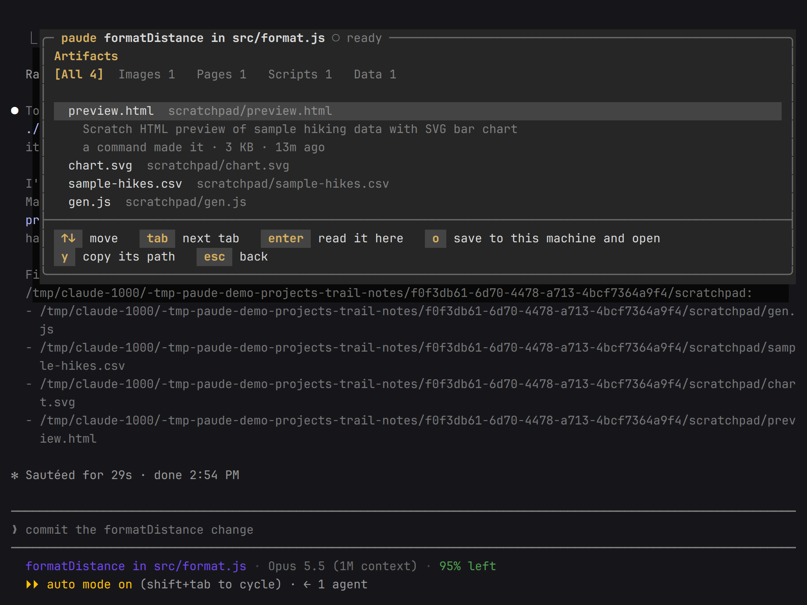

In **f**, the reader: arrows (or j/k) move and Enter opens; **/** finds a file by name, **?** searches contents, and **c** lists changes: what Claude proposes, what changed since the last commit (the tree marks those files M, A, D, R or U, as VS Code does), and what each of Claude's turns changed. Alt+C, Alt+W and Alt+R toggle match case, whole word and regex, as in VS Code, and Tab moves to the files to include and exclude. Code is highlighted and markdown is rendered (**m** shows the source; the choice is remembered). In kitty, WezTerm or Ghostty, images show in place.

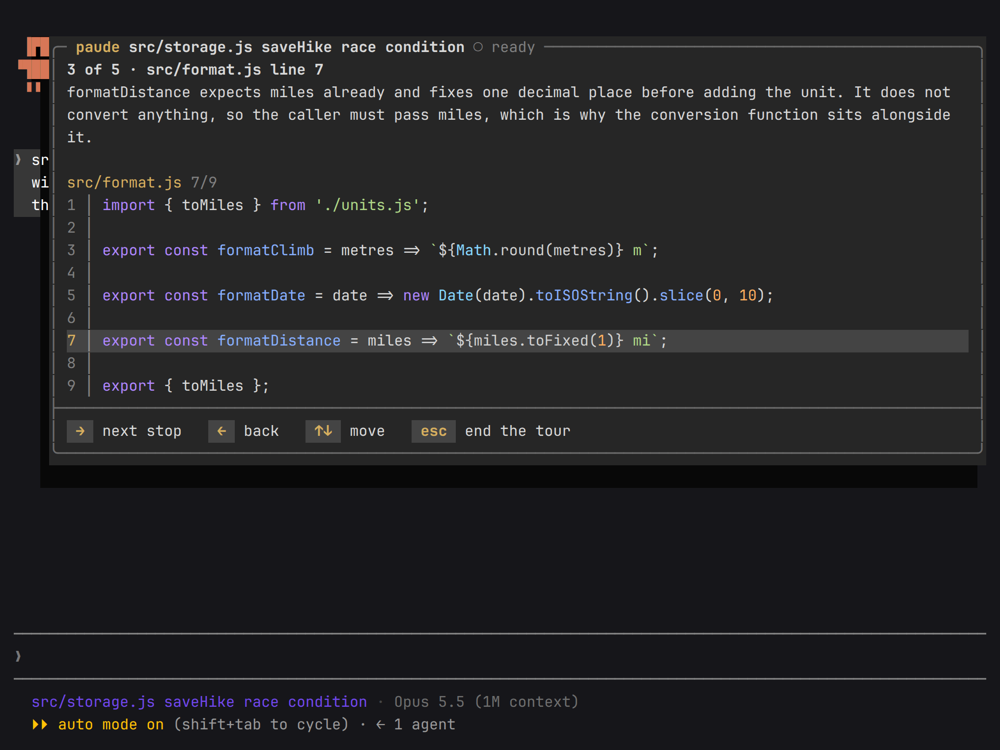

| Key   | In a file                                                                                                |
| ----- | -------------------------------------------------------------------------------------------------------- |
| **v** | mark lines from the cursor                                                                               |
| **a** | attach the marked lines, or the whole file, to Claude's prompt (nothing is sent until you press Enter)   |
| **M** | comment on the marked lines, or the line the cursor is on; a blue bar marks lines open comments are on |
| **y** | copy them to your clipboard                                                                              |
| **z** | full screen                                                                                              |
| **e** | edit it in your editor, in the terminal; quitting the editor comes back here with the file reloaded |
| **c** | its changes, if it has any                                                                               |
| **w** | walk me through: a tour of the marked lines, or the whole file; **→** and **←** step through it, each stop marking its lines, and **Esc** (or leaving the file) ends it |

In a diff, **v** marks lines, **a** attaches the marked lines (or all of it) as a diff, **M** comments on them (marked in one file; from a removed line into the lines that replaced it, the comment is on both), **y** copies, **o** opens the file under the cursor, **s** switches between side by side (where the box is wide enough) and unified, **w** walks you through the change, and **O** changes the order a diff of several files reads in (reading order, largest change first, alphabetical, by function). A folded generated file opens with **Enter**, or by itself when a comment in it is opened. **e** uses `$PAUDE_EDITOR`, `$VISUAL` or `$EDITOR` when it names an editor that runs in a terminal, and otherwise the first of nvim, vim, nano and vi that's installed.

In kitty, an attached session tints the window with the session's color, as in the browser, and puts the window's own colors back on leaving. A session that won't start (its folder gone, Claude Code missing) says why instead of waiting.

`PAUDE_NAME` sets the name others see (default: your username). `paude logout` revokes this machine's token on the server.

## In the browser

Open the server's address and log in, or follow an invite link.

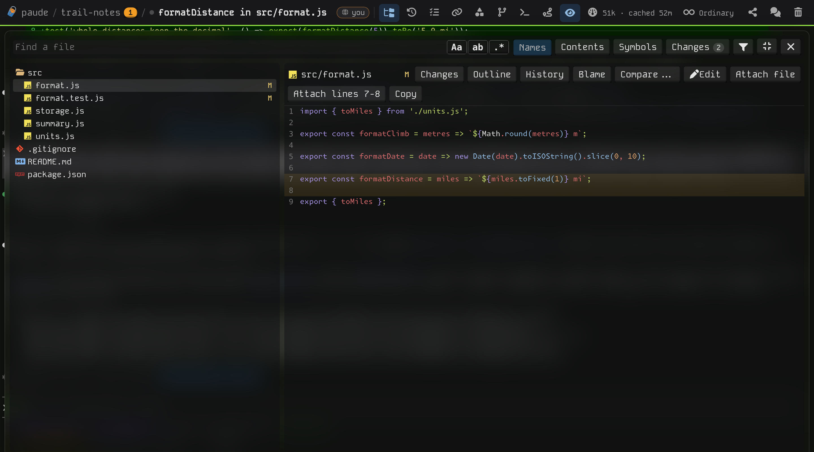

- **Colors.** Each session has a color of its own, from its id: its screen's background, the edge of its bar, and a stripe on its card, so sessions in one project tell apart at a glance. A project's card takes its folder's color instead. The hues and tints are those of kitty-bg, which tints a kitty window by its folder.
- **Dropping files.** Drop a file on the terminal, or paste a screenshot, and it's saved on the session's machine (in `~/.paude/attachments`, outside the project) and its path put in Claude's prompt; an image's path becomes an attached image. It takes the drive role.
- **Size.** A session has one size, set by whoever typed last; everyone else sees it scaled to fit.
- **Scrolling.** The wheel scrolls Claude's transcript, for everyone, since there is one screen.
- **Git.** The branch button in a session's bar opens the Git panel: what's staged and what isn't, with a button to stage, unstage or discard each file (or all), and a commit box (Ctrl+Enter commits; it can amend). **Claude, write it** has a Claude of its own read what's staged, and the session's turns that changed those files, and write the message in the repository's style, for you to edit: the subject says what changed, and a body says what was chosen, what was turned down and why, when the change holds a decision. The session's own conversation is left alone. The commits not pushed yet are listed as concerns, each with its message: a change (or only its reasoning) can be filed into one of them, with the whole message that commit will have, and **Settle** folds what was filed into each, ready to push, leaving work not committed where it was. Its bar names the repository (the session's folder's, which isn't always the one Claude is working in) beside the branch, with fetch, pull (fast-forward only) and push; a first push tracks origin. History lists the commits, and clicking one shows its changes in the files panel. **Review** shows what the branch adds beyond the main line (its commits, and its changes in the files panel, with the work not committed yet read alongside, as what the branch would propose once it is) and its pull request through GitHub's `gh`: open one, then watch its state and checks. Before you open it, a short list says what's still to see to: files changed and not committed (which a pull request leaves out), comments still open, and whether what changed was tested since. **Claude, write it** drafts the title and description from the commits, a walk-through of the change (one you already took is reused) for a "how to review it" in that order, and what was seen of its testing, saying so when tests are stale, failing or never ran. **Your review** there remembers, for you alone, the commit you've reviewed the branch up to, by its repository and branch rather than the session, so a review in a new worktree carries on from it: next time, **Show what's new** is just the commits since, or, once the branch was rebased or force-pushed, how its own files differ from what you read. Marking it takes no more than reading. A merge, rebase or cherry-pick that stops on conflicts can be settled from **Changes** (keep mine or theirs for each file) and carried on or given up. Branches makes, switches and deletes them (git keeps one whose work isn't merged, and says so); Stashes stashes the changes and brings them back. Reading takes the comment role; changing anything takes the drive role.
- **Activity.** The clock in a session's bar shows what Claude did, turn by turn: each prompt, how long it took, and the tools Claude used in order (what it read, edited and ran, and whether each worked), with how much context the session is using. An edit opens the turn's changes, a read opens the file, and a command shows what it printed. At the top, whether what changed has been tested since: the session's test runs (the ones Claude ran, by their commands, and the Tasks panel's) against when each changed file last changed on disk, however it was changed. It says the tests passed after the last change, how many files changed since the last passing run (naming the run as it was typed, so a run of a few tests reads as that), that the latest run failed, or that nothing has been tested. A run piped through another command is judged by the runner's own counts, not how the pipe exited. The same line heads the Git panel's Review tab and the catch-up tour. A step you turned down at its permission prompt is marked so, not as a failure.
- **Links.** The link button gathers every link that came up in the session: in your prompts, Claude's replies, pages it fetched or searched, and the chat and comments, each with who brought it up and how often. Haiku describes each one in a few words from what was said around it, once per link, in the background through your Claude login (until it has, the clearest sentence said about it shows). They're sorted into docs, tickets, repos, servers and the rest, the latest day first and the most mentioned first within a day; pin the ones that matter, hide the noise. Links only a command printed are left out unless you ask for them, and the contents of files Claude read never count. A project's page has the same list across its latest sessions, each link naming the sessions it came up in.
- **Decisions.** The scales button lists what the session settled: decisions (what was chosen, what was turned down, and why), directions you gave, and work put off. Haiku reads each finished turn once, with what you sent while Claude worked and what you said next, since what Claude proposed is settled only when you agreed to it. It runs as the session goes, from each prompt and each turn's end, not only when the panel is open, and a push Claude runs waits for it: once something was filed, the push is turned back to settle the stack first. Then it looks for each in the places things get recorded: the commits since, the project's CLAUDE.md and AGENTS.md, your own CLAUDE.md and skills, and the `.lld.md` design documents. What's recorded nowhere, paude files into the commit not pushed yet that changed the same files, once the turn is over: Claude rewrites that commit's whole message as an `amend!` that folds in at settling, without touching your staged or unstaged work. Once that commit is pushed its message is final, so what explains it goes in a commit of its own, which changes no code and ends `Explains <sha>.`; the commit view shows it under the commit it explains. paude knows which commits a turn made from a note it adds to each, on a local `refs/notes/paude` that git carries through amends and rebases. When a turn ends, paude also looks back over the project's other sessions, once each and whole, including ones from before it followed them: what they settled goes into the commits of their day, the first after the turn to change its files. Nothing is filed while another session works in the same repository, or while any session's push runs, wherever it goes. A decision that is design intent goes into the design document it belongs in, and one that overrules a document's claim changes that claim: Claude drafts the claim with a perspective that checks it, lldtdd runs the document as it was and as drafted, beside your working tree in a checkout of its own, and the draft is committed only if a claim more passes (or one fewer fails) and nothing else gets worse. One the code doesn't hold, never built or overruled since, is marked as checked and nothing is written; it is looked at again when the code changes. This needs lldtdd installed in the project, and the document unchanged in your working tree. What it can't settle from the conversation (which way was taken, whether it still holds, why), it asks you in the panel rather than guesses, and your answer goes into the message; a question about an earlier session shows in any of the project's sessions. What has no such commit leads the list. The owner can ask Claude to record one, and Claude picks where (the message of the commit it shaped, CLAUDE.md, the design document); anyone who can comment can set one aside as not worth it.
- **Artifacts.** The shapes button gathers what the session made along the way, wherever it landed (Claude's scratchpad, `/tmp`, an ignored folder): screenshots, pages, scripts, data, docs. They come from its transcript: files Claude wrote or looked at, and files its commands named, that are still there, were written once the session named them, and aren't tracked by git (those are its changes). Each says what it is and what it was for (Haiku writes it from what was said as it was made and, for a text file, how it begins), opens in the files panel (read-only when it was made outside the project; **Open** there shows a page or SVG as it is, in a sandbox, away from paude), downloads, or copies its path; images show a preview, and open over the page, fitted to the screen (press to see it at its own size; the arrow keys or a swipe step to the next). A project's page lists what its sessions made, each with the session it came from. A guest sees only what's inside the project.
- **Tasks.** The checklist in a session's bar runs the project's own commands: its package.json scripts (with the package manager its lockfile names), Makefile targets, justfile recipes, and Cargo, Go and pytest checks. A run's output streams in; a test run shows its counts; and the problems in what it printed (`file:line` from compilers, linters and test failures) are listed, each opening its file at the line, all of them ready to attach to Claude's prompt. A task can run after each of Claude's turns that edits files, so the problems stay current. The same panel lists what the session is running, with its memory and CPU, and stops any of it.
- **Managing files.** The files panel manages the project's files as an editor's explorer does. Right-click a file or folder (press and hold on a phone), or the list's empty space for the project itself: new files and folders, rename (F2), duplicate, cut, copy and paste into another folder (Ctrl+X, Ctrl+C, Ctrl+V), delete (Delete), upload files or a whole folder, download, copy its path, attach it to the prompt, compare it, or search inside a folder. Ctrl+click (Cmd+click) and Shift+click pick several, as do Shift and the arrow keys; drag them onto a folder to move them, holding Ctrl or Alt to copy, or drop files from your computer onto one to upload them. A move or a delete can be undone for a moment after: what's deleted waits a day in `~/.paude/trash`. A new path's folders are made with it, nothing is ever written over without asking, and nothing goes outside the project. Managing files takes the drive role.
- **Search and replace.** The files panel's Contents search has a Replace box: every match across the project replaced at once, after asking (a regular expression's replacement can use its groups, `$1`). Regular expressions, in search and replace, are JavaScript's. With nothing typed, it offers the project's to-dos: TODO, FIXME, HACK and XXX.
- **Environment.** The Tasks panel shows what the session's processes see in their environment, and what the project's `.env` files set, never sending a secret's value: a name that sounds secret, and every `.env` value, shows only its length.
- **Finding your way.** Ctrl+P (Cmd+P) finds a file from anywhere on the session's page but its terminals, and a `#` first there looks for a symbol instead; Ctrl+Shift+F searches inside the files, and Ctrl+Shift+O lists the open file's outline. In the files panel, **Symbols** finds functions, classes and types across the project, and **Outline** lists the open file's. Back and forward (the arrows by the file's name, Alt+Left and Alt+Right, Ctrl+- and Ctrl+Shift+- on a Mac, or a mouse's own buttons) step through what you've read. Ctrl+click (Cmd+click) a name in a file to go where it's defined, with Shift to list everywhere it's used; on a phone, select the name and **Definition** and **Uses** appear. It reads each language's declarations (JavaScript and TypeScript, Python, Go, Rust, Ruby, Java, Kotlin, C#, PHP, C, shell and more) without a language server, so it works in any project at once, if less exactly than a compiler would.
- **A file's past.** In the files panel, **History** lists the commits that changed the file open, and **Blame** shows beside each line who last changed it; either opens that commit.
- **Breadcrumbs.** Every page's bar says where it sits: the paint bucket (paude, home) / the project / the session, each a link up. Beside the bucket, a badge counts the other watched sessions waiting for you, on any server, and pressing it lists them to open.
- **Comments.** Drag over the terminal to select (on a phone, **Select** on the key bar, then tap the first and last line) and press **Comment**. Clicking a comment's quote finds it in the terminal. Lines picked in a file or a diff take a comment too: it names the file and lines (and the commit they were read at), a bar beside them marks it in the reader and in any diff of the file, and clicking either opens the other. In a diff, the lines can be the ones a change removed, or a change and what replaced it (picked from a removed line down into the added ones), and the comment is on both sides; one written in a diff opens in that diff again, its lines picked. Its lines are followed through what changes after: lines added or removed above them move it, and once its own lines change it no longer marks them. **Attach** puts a thread (where it is, what it quotes, who said what) in Claude's prompt, and **Attach all N open** puts every open thread there at once, to address them. What came from GitHub is marked as outside words, from someone who isn't in the session, to weigh rather than to follow. Reactions work on chat, comments and replies; click one to add or take back yours. **Ask Claude** beside Send (or Ctrl+Enter) sends a chat message, comment or reply to Claude as well, once its prompt box is empty and it isn't asking anything; a comment brings its quoted output along. Only those who may type into Claude see it. Whoever wrote a comment or reply can delete it (a comment takes its replies with it), and the owner can delete any. Where the branch has a pull request, **From the PR** brings in its review threads as comments on their lines (an outdated one on the lines it was written on), catching up those already here with new replies, and following GitHub's resolution when it changes there. **Post to the PR** (the owner's, since it goes out as their `gh` login) first shows exactly what goes: each open comment on lines, chosen one by one, on its lines (one on a change and what replaced it, on both sides of GitHub's diff), (once the pull request's latest commit is fetched here, so the lines are followed to it) or in the review's text when GitHub won't take it there (the pull request doesn't change those lines, or the comment's own lines changed since it was written; lines that only moved are followed to where they are), with why; then a summary, and whether it comments, approves, requests changes, or is left pending on GitHub. Other people's comments go with their names on; Claude's answers stay here. A comment posted is marked so, and its replies on GitHub come back to it. The same review is never posted twice: if one just like it (yours, at that commit, saying the same) is already on the pull request, say because `gh` lost track of a post that went through, that one is kept.
- **Files.** The reader, from the folder button in the bar: search by name or contents with the same options as the terminal, and read highlighted code, rendered markdown, images, audio, video and PDFs. Click a line number and Shift+click another (on a phone, tap another) to attach those lines.
- **Changes.** The reader's **Changes** lists what Claude proposes while it waits on a permission prompt, what changed since the last commit (staged or not, and marked in the tree), and what each of Claude's turns changed. **Compare...** on a file you're reading diffs it against another. Every diff reads the same way, side by side where there's room (**Unified** switches, and the choice is remembered): attach a hunk, the lines you pick, or all of it. A turn shows what Claude's own edit tools changed; changes made by commands it ran (`sed`, `rm`) aren't recorded by Claude Code, so they show only against the last commit. A diff of several files reads in **reading order** unless you pick another (the button in its bar, remembered): what's used before what uses it (by the imports between the changed files, in JavaScript, TypeScript and Python), each file's tests right after it, then tests of nothing changed here, config, docs, files only moved or changed in whitespace, and last what's generated (lock files, build output, snapshots). **By function** reads the change one function, class or type at a time (as far as the files' outlines tell, in the languages Symbols reads): those whose signature changed first, since their callers may have had to change too, then new ones, then those changed inside, each followed by the hunks that use it (in another file, only one that imports it, where imports can be read), and last what falls in no function. A file can then show in parts, each saying its part (`signature changed`, `new`, `uses scale`). **Largest change first** and **Alphabetical** (git's own order) are the others. Each file says what it is to the change (`tests lib.js`, `config`, `whitespace only` for code only re-indented or re-wrapped, `moved, unchanged`, `renames sum → add`, `generated`). A rename swept across files (the same words swapped, and nothing else changed, in two or more files) is read once under one heading, `Renamed sumUp → addUp in 14 files`, its files folded like a generated one until you show them. It's all worked out from names, imports and the diff, so it's the same every time.
- **Editing.** **Edit** on a file you're reading; Ctrl+S saves. The editor takes the keys VS Code and Sublime use: Ctrl+F finds and Ctrl+H (Cmd+Alt+F on a Mac) replaces, with case, whole-word and regular-expression toggles (the magnifier does both on a phone); Ctrl+D picks the next occurrence to edit them all at once, and Ctrl+Shift+L every one; Alt+click adds a cursor, Ctrl+Alt+Up and Down one a line away, and Shift+Alt+drag selects a column; Alt+Up and Down move the line. Ctrl+/ comments lines out and back in, Ctrl+G goes to a line, Alt+Z wraps long lines (and remembers it), and brackets and quotes close themselves. Tab indents the way the file already does, with tabs or spaces. An edit not yet saved is kept in your browser as you type, so a reload or a dropped connection doesn't lose it: opening the file again offers it back. If the file changed since you opened it (Claude saved it, most likely), saving stops and asks whether to save yours anyway or load theirs.
- **Terminal.** The terminal button in the bar opens a shell in the session's folder, yours alone, which ends when you close it. Select some output (on a phone, **Select**, then the first and last line) and **Attach selection** quotes it in Claude's prompt.
- **Start over from a point.** Each `done` line Claude prints after a turn is a link that starts a new session holding the conversation up to there.
- **Finding a session.** Home's search box looks through every session, and a project's through its own: each word you type has to appear in the title, the prompt it began with, the project, branch or worktree. **Show more** pages on. In the terminal, **/** in the picker does the same as you type.
- **Names.** Click a session's title to pin a name; **Use automatic name** goes back to Claude's.
- **Answering from a phone.** When Claude asks for a permission or asks a question, its question and each answer show as buttons over the terminal on a phone, and on the session's card on the home page: a tap presses that answer's number, as long as Claude still asks that. Answers that need typing (Claude's "Type something") are left to the terminal. The notification that a session needs you says what Claude asks.
- **Usage limits.** When a usage limit stops Claude's turn, a card says when it resets (as Claude said it) with **Continue when reset**, or **Continue** once it has. Claude Code carries on by itself at the reset unless that's turned off, or the reset came while the machine slept; paude waits two minutes past it and carries on only if Claude hasn't. When Claude didn't say when, paude tries every half hour, a try that's still limited costing nothing.
- **Cache and cost.** The gauge in a session's bar (the owner's) shows how big the conversation is and how long Claude's prompt cache still holds it; its menu says what the next message costs, what the session has spent and how much came from the cache, in input-token equivalents (what the tokens would cost as plain input), with **Compact now** and **Keep warm**. Coming back to a big conversation the cache has let go of, a card says what the next message costs and offers to compact first.
- **Where a prompt goes.** Home's box takes what Claude should do before it goes anywhere: **Find where it goes** has Haiku weigh it against the conversations going (running, or touched in the last three days: their titles, latest prompts and the files they changed) and say which it carries on, if any, and why, with what sending it there costs (cached, or the whole conversation cached again); or which project a new session belongs in, whose page it then opens with the prompt in its box, to pick a worktree. A project's page has the same, kept to its own sessions, beside **Start session**; the chips along the box's bottom pick where the new session works (the project folder, a worktree, or a new one) and how long it lasts. Below it, the project's sessions, the links they brought up and what they made each have a tab.
- **Catch me up.** The route button first says what the tour is and asks; taken, it tours what happened since this browser last had the session open (or the last ten turns): Haiku writes an overview and a stop for each turn, and where you steered is marked and told: a turn you stopped, the one that redirected it, a step you turned down. The overview says whether what changed was tested since, and what the tour leaves out (a prompt sent again, the earliest turns past the 25 a tour holds, or what came before the part of a long session it reads), and each stop scrolls the terminal to where that turn began, or, once it's older than what the terminal keeps, opens it in Activity. Anyone in the session can take the tour, so it's handy for someone you've shared it with; a tour of the same turns is written once (the latest 50 tours are kept).
- **Walk me through.** The same kind of tour, of code: in the files panel, **Walk me through** on a file offers the whole file, the lines picked, or any of its functions, classes or types (from its outline), and on any diff (a file's changes, a turn's, a commit's, the branch's, what's new since your review) it tours the change. Haiku writes an overview and a stop for each part, in the order that explains it best rather than top to bottom; each stop picks its lines, in the file or the diff, with its explanation above them. The overview says what the tour leaves out: stretches of the file or changes in the diff no stop is on, what was too long to read, and any stop that pointed at lines that aren't there. Anyone who can read the project can take one; a tour of the same thing is written once (the latest 50 tours are kept).

The side panels float over the terminal and resize from their inner edge.

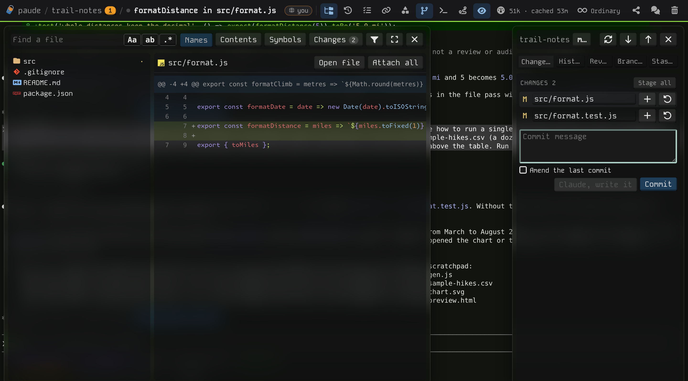

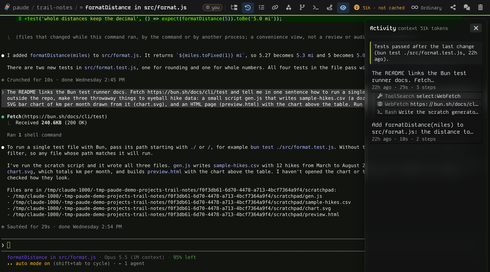

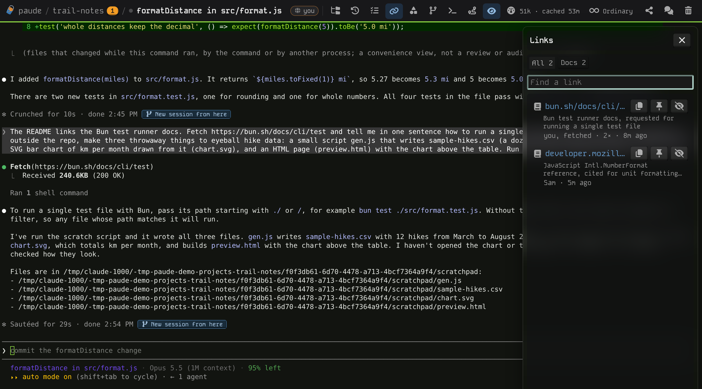

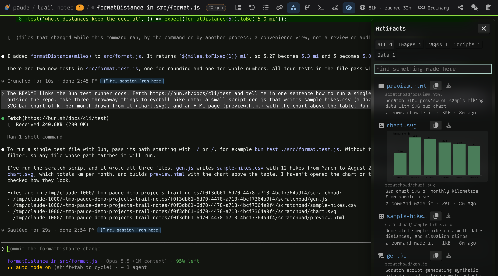

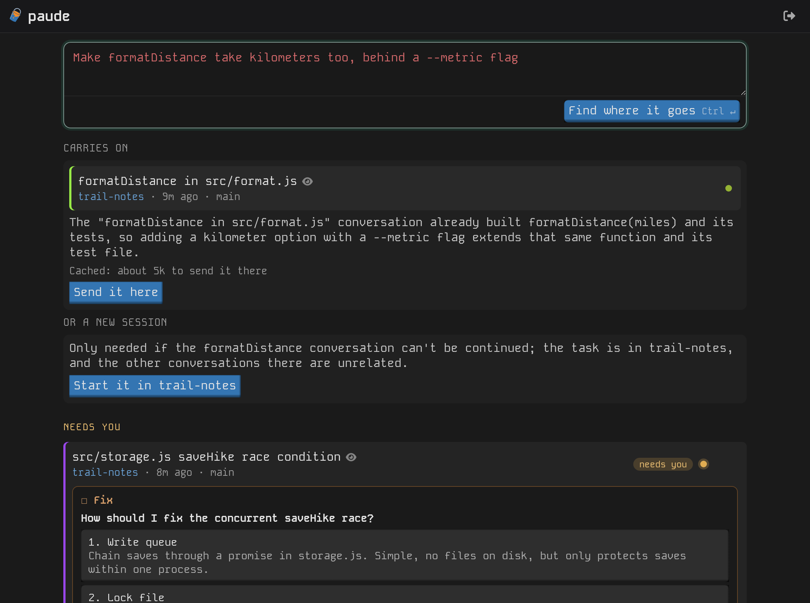

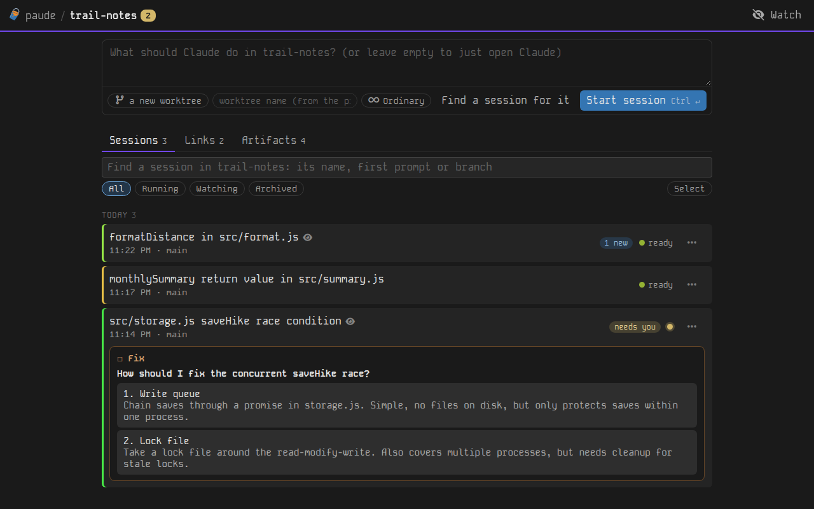

## Watching

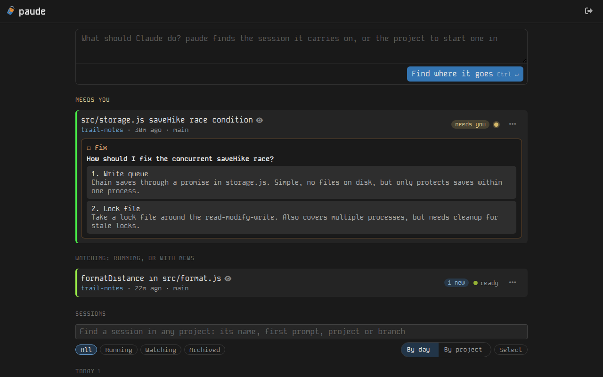

Home heads its lists with the watched sessions that need you, always in sight, and then the watched ones with something going on: running, or with news since you looked. Under them every session, newest first, with a search over all of them (name, first prompt, project, branch) and chips for the ones **Running**, **Watching** or **Archived**. With neither, they're grouped by the day they last changed, or **By project**: each project a heading with its sessions, how many are running and when it was last busy, opening to its newest sessions (the watched and running ones open to begin with); adding a folder is at the end. Every card and project has a **⋯** menu, also on a right-click or a press and hold: watch or stop, rename, archive, copy its link, delete. **Select** picks several to archive, watch or delete at once. An archived session leaves the lists but not a search or the Archived chip, and opening it again brings it back; a project's page lists its sessions the same way.

The `paude` picker in the terminal lists them the same way, across every paude you're logged into: what needs you, what's going on among the watched, then every session by day or by project (**g**, remembered). **/** searches all of them, **Tab** steps through Running, Watching and Archived, and on the session under the cursor **w** watches or stops, **a** archives or brings back, **r** renames, **d** deletes (after asking), and **u** undoes a watch or an archive. **Space** picks several for **w**, **a** or **d** at once. By project, **→** and **←** open and close one, and **Enter** opens its own list with a new session at the top. A watched session says what it's doing (**working**; **needs you** when Claude is asking for a permission or an answer; **ready** for the next prompt) and how many turns, chat messages and comments landed since you last looked. Watching starts on its own the first time you join a session by invite, post in it, or prompt it; the eye in the session's bar, or **w** in the picker, turns it off and on.

When a watched session starts waiting on you or has news, you get a notification: in the browser once the bell in the chat panel is on (the tab title also counts the sessions waiting on you), and in the terminal through kitty, iTerm2, WezTerm and others that show them. Opened from this machine (the `paude` command, or `paude web`), the home page also lists the sessions on every server your `paude` command is logged into, and opens them there already logged in.

### Keeping a session warm

Claude Code keeps a conversation in its prompt cache for an hour after Claude last did anything; 54 minutes in, it compacts an idle conversation of 200k tokens or more down to a summary, rather than reread all of it uncached when you come back (`"idleCompaction": false` in Claude Code's settings turns that off). **Keep warm** (the lifetime button in the session's bar, for the owner) holds it as it was for 12 hours: whenever Claude has been quiet for 50 minutes, paude types in a ping that Claude answers with a dot, which reads the conversation from the cache and keeps it there. A ping waits while Claude is working, asking something, or has something typed in its prompt box, and its turn isn't counted as news for anyone watching. Each costs a cached read of the whole conversation (about a tenth of reading it fresh), so it's worth it for deep work you'll come back to, not for every session. A session kept warm isn't closed for sitting unattended, and stops being kept warm when it ends.

A new session can start either way: the project page's lifetime chip, set to **Kept warm**, starts it with keep warm on, and **Short-lived** marks it for one quick thing. A short-lived session is ended and deleted (transcript, chat and comments, and its worktree once nothing else uses it) once Claude's cache has let go of it, about an hour after its last answer, with nobody in it and Claude neither working nor asking; one never prompted goes an hour after it started. Home's prompt box suggests one for a new session from what the prompt asks (a quick question starts short-lived, deep work you'll come back to starts kept warm), already picked on the project page it opens. A session's bar shows how long it lasts by name (∞ ordinary, the coffee cup kept warm, an amber hourglass short-lived), as does the start of its title in session lists (☕, ⏳), and its menu changes that whenever. For an hour after a switch, what it was before stays on show, struck through, and the menu's **Put back** returns it. The gauge beside it is the cache, not the switch: it reads *cached 42m* or *not cached*.
